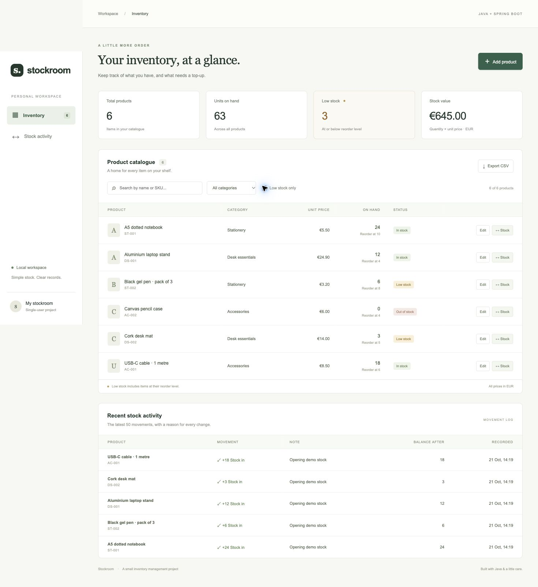

# Stockroom

A small inventory management app built with **Java, Spring Boot and H2**. It tracks products and stock movements for a single local workspace, such as a stationery cupboard or small campus shop.

This is a personal learning project with a deliberately limited scope: one screen, two database entities and a conventional controller → service → repository structure.



## What it does

- Add products and edit their SKU, name, category, unit price and reorder level.
- Record incoming and outgoing stock with a short reason.
- Reject withdrawals that would make stock negative.
- Show quantities, stock value and products at or below their reorder level.
- Search by name or SKU; filter by category or low-stock status.
- View the latest 50 stock movements, including the balance after each change.
- Export the current catalogue as a CSV file.
- Keep local data between restarts, or use a separate resettable demo mode.

## Run locally

You need **JDK 21 or later**. Maven is downloaded automatically by the included Maven Wrapper; the first build needs internet access. No separate database or Node.js installation is required.

macOS / Linux:

```bash
sh ./mvnw spring-boot:run
```

Windows PowerShell:

```powershell
.\mvnw.cmd spring-boot:run
```

Open **http://localhost:8080**. The normal workspace starts empty and saves its H2 database under `data/`, relative to the folder you run the app from. That folder is excluded from Git. Stop the app with `Ctrl+C`.

### Try the sample catalogue

```bash
sh ./mvnw spring-boot:run -Dspring-boot.run.profiles=demo
```

On Windows, replace `sh ./mvnw` with `.\mvnw.cmd` and quote `"-Dspring-boot.run.profiles=demo"` if your shell requires it. Demo mode contains six fictional products. Its database is held in memory and resets when the process stops; it does not change the normal workspace.

Try receiving 5 units of black gel pens, withdrawing 2, and filtering to low stock. To see the validation, try withdrawing more units than are available. Export the CSV to inspect the resulting balances.

### Test and build

```bash
sh ./mvnw verify
java -jar target/stockroom-0.0.1-SNAPSHOT.jar
```

The tests use a separate in-memory database. They cover input validation, case-insensitive SKU uniqueness, stock movements, failed withdrawals, reorder boundaries, value calculations, CSV escaping and competing withdrawals for the same item. GitHub Actions runs the same build on Java 21.

## Design

```text
Browser (HTML / CSS / vanilla JavaScript)
              │ JSON over HTTP
       InventoryController
              │
        InventoryService
              │
 ProductRepository + MovementRepository
              │
          H2 database
```

- `Product` stores the current catalogue and quantity.
- `StockMovement` stores the product, direction, units, reason, time and resulting balance.
- New products start at zero. Quantity is changed only through stock movements, so the normal API cannot silently overwrite it.
- A transaction saves the balance and movement together. A database row lock prevents two withdrawals for the same product from using the same old balance.
- Unit prices use `BigDecimal` with two decimal places. Stock value is quantity × the **current** unit price; it is not an accounting valuation or revenue measure.
- SKUs are normalized to uppercase, with a database uniqueness constraint as a final safeguard.
- CSV text is quoted, internal quotes are doubled, and formula prefixes are neutralized before export.

There are no extra services, frontend frameworks or build pipelines beyond Maven and a small CI workflow.

## API examples

Create a product:

```bash
curl -i http://localhost:8080/api/products \
  -H 'Content-Type: application/json' \
  -d '{"sku":"NB-001","name":"Notebook","category":"Stationery","unitPrice":5.50,"reorderLevel":5}'
```

Use the returned `id` to receive stock:

```bash
curl http://localhost:8080/api/products/1/movements \
  -H 'Content-Type: application/json' \
  -d '{"direction":"IN","quantity":10,"note":"Opening delivery"}'
```

Use `"OUT"` to withdraw units. A rejected withdrawal returns HTTP `409` and leaves both the balance and movement history unchanged.

Other endpoints:

- `GET /api/products` — full catalogue.
- `GET /api/products/{id}` — one product.
- `PUT /api/products/{id}` — edit catalogue fields using the same fields as creation.
- `GET /api/summary` — product count, units, low-stock count and value.
- `GET /api/movements` — latest 50 movements, newest first.
- `GET /api/export` — all products as CSV, independent of browser filters.

Invalid input returns `400`; a missing product returns `404`; duplicate SKUs and insufficient stock return `409`.

## Scope and limitations

This app is intended for local learning and demonstration. It binds to `127.0.0.1` and has no accounts, login or permission system. It should not be exposed as a shared production service without adding authentication and deployment controls.

It supports one workspace and EUR only. Products are retained to keep their movement references; there is no delete feature. The activity panel shows the latest 50 records, while older records remain in the database. Product names and SKUs in the history reflect the current catalogue; the log is not an immutable accounting audit. Sample data is fictional.

Possible small extensions: pagination for the history, archiving discontinued products, or adding a supplier field.

## Learning references

The project idea combines basic catalogue management with a stock movement log. The implementation is specific to this app; no existing inventory repository was copied.

- [Spring: Building a RESTful Web Service](https://spring.io/guides/gs/rest-service/)
- [Spring: Accessing Data with JPA](https://spring.io/guides/gs/accessing-data-jpa/)
- [Spring: Validating Form Input](https://spring.io/guides/gs/validating-form-input/)

For a short Chinese walkthrough of the code, see [學習筆記](docs/learning-notes.zh-TW.md).
